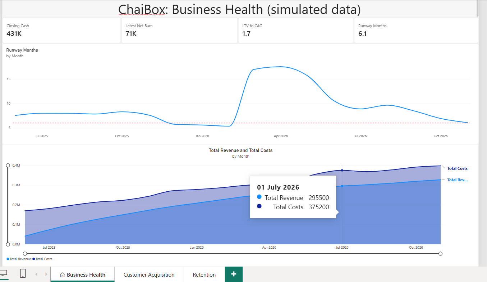
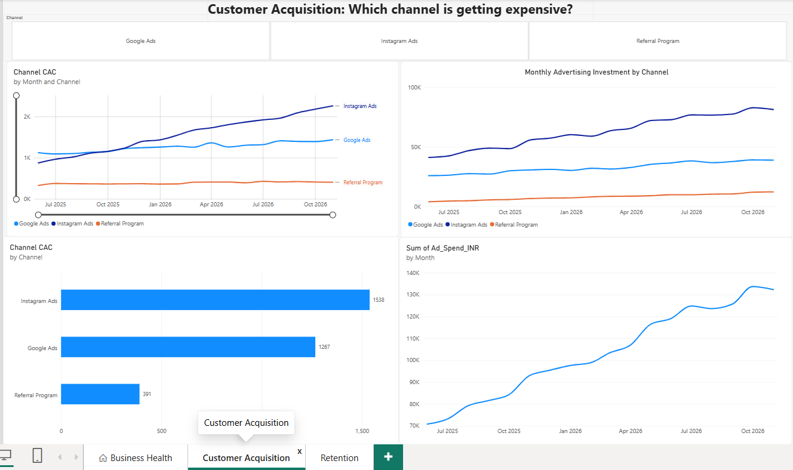
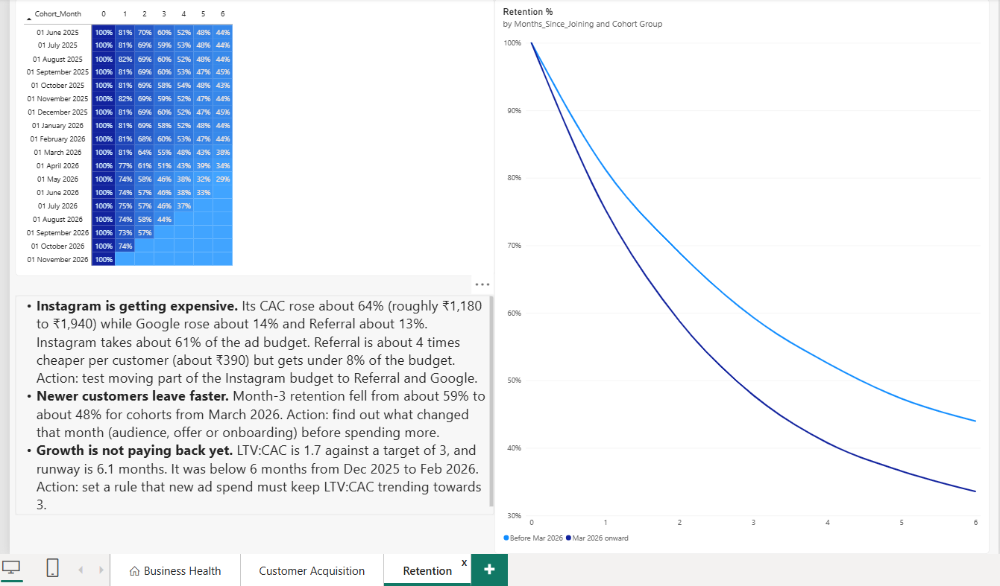
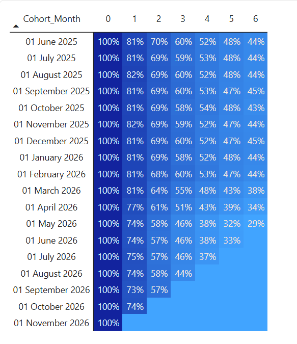
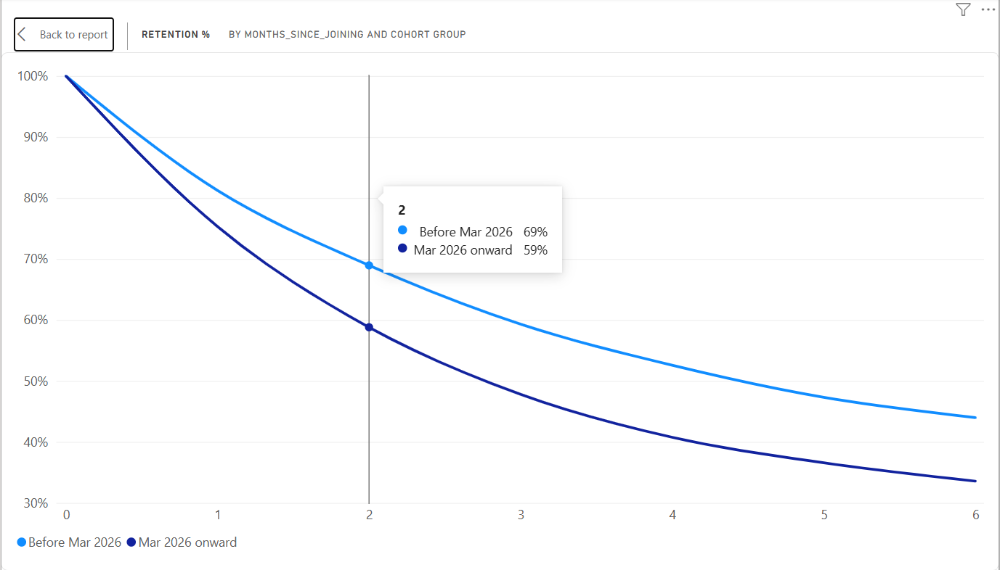

# ChaiBox: Financial KPI Analysis for a Startup

> **Simulated data.** ChaiBox is a fictional monthly tea-box subscription startup. Every figure in this project is simulated for learning and does not describe a real company.

An Excel, Python and Power BI analysis of burn rate, runway, customer acquisition cost (CAC), customer lifetime value (LTV) and cohort retention. It shows why a fast-growing subscription startup is not yet earning back what it spends on growth.

## The problem

ChaiBox has 655 paying customers (Nov 2026) and about 6 months of cash left. It wins customers through Instagram Ads, Google Ads and a Referral Program, but each customer is worth only about 1.7 times what it costs to win them. A healthy subscription business is usually closer to 3 times. Where is the money going, and what should the founder test first?

## Key findings

| Finding | Evidence | Action to test |
| --- | --- | --- |
| Instagram is getting expensive | CAC up about 64% (about ₹1,180 to ₹1,940, first vs last 3 months). Google up about 14%, Referral up about 13%. Instagram takes about 61% of ad spend. Referral costs about ₹390 per customer but gets under 8% of spend. | Shift part of the Instagram budget to Referral and Google and compare CAC. |
| Newer customers leave faster | Month-3 retention fell from about 59% to about 48% for cohorts that joined from Mar 2026. | Find what changed in March 2026 before spending more. |
| Growth is not paying back yet | LTV:CAC is 1.7 against a target of 3. Runway is 6.1 months, and it was below 6 months from Dec 2025 to Feb 2026. | Require new ad spend to move LTV:CAC toward 3. |

The data shows what happened, not why, so each action is something to test.

## Power BI dashboard

Open `powerbi/` for the report file. Screenshots of each page:

**1. Business Health** (cash, burn, runway, LTV:CAC, revenue vs costs)


**2. Customer Acquisition** (CAC and ad spend by channel)


**3. Retention** (cohort heatmap, earlier vs later cohorts, findings)


## Retention analysis (Python)

The notebook in `notebook/` turns cohort counts into retention percentages.





## Repository structure

```
chaibox-kpi-analysis/
├── README.md
├── requirements.txt
├── data/        CSV files used by the notebook and Power BI
├── excel/       ChaiBox_KPI_Model.xlsx: data sheets plus formula model
├── notebook/    ChaiBox_Cohort_Analysis.ipynb (already run, outputs visible)
├── powerbi/     Power BI report (.pbix)
├── report/      2-page project report (PDF)
└── images/      dashboard screenshots and retention charts
```

## Tools

| Tool | Used for |
| --- | --- |
| Excel | 423-formula KPI model (SUMIFS, IF, IFERROR): burn, runway, churn, LTV, CAC, LTV:CAC, CAC by channel |
| Python (Pandas, Matplotlib, Seaborn) | Cohort retention table, heatmap, earlier vs later cohort comparison, CSV exports |
| Power BI Desktop (DAX) | Measures, KPI cards, line and bar charts, retention matrix with colour-scale heatmap |

## Metric definitions

- **Net burn** = total costs − revenue (per month)
- **Runway (months)** = closing cash ÷ net burn
- **Churn rate** = customers lost this month ÷ customers active last month
- **Customer lifetime (months)** = 1 ÷ churn rate
- **LTV** = margin per customer per month × customer lifetime
- **Blended CAC** = total ad spend ÷ new customers
- **LTV:CAC** = LTV ÷ CAC (3 or higher is a common rule of thumb for healthy)
- **Retention %** = customers still active ÷ customers in the cohort

## How to run

1. Install Python 3.10 or newer, then run `pip install -r requirements.txt`.
2. Start Jupyter (`jupyter notebook`) and open `notebook/ChaiBox_Cohort_Analysis.ipynb`.
3. Run all cells from top to bottom. The notebook reads `excel/ChaiBox_KPI_Model.xlsx` and writes charts to `images/` and CSV files to `data/`.
4. For the dashboard, open the `.pbix` file in Power BI Desktop (Windows). If it asks for the data location, point it to the CSV files in `data/` (Home → Transform data → Data source settings).

## About the data

The workbook holds 18 months of simulated figures (Jun 2025 to Nov 2026): monthly customers, revenue, costs, funding and cash, ad spend and new customers for three channels, and cohort counts. Realistic trends and random noise were used, and a few patterns (rising Instagram CAC, weaker retention for newer cohorts) were built in so there was something to find. The value of the project is the method: calculating the metrics, checking them, and turning them into decisions.

## Limitations

- The data is simulated, so the findings show the method and not a real business.
- CAC counts ad spend only, not salaries or other sales costs.
- LTV assumes a steady churn rate.
- The newest cohorts have only a few months of history.

## Author

Pranjal Singh · [GitHub](https://github.com/Pranjal-Singh07)
